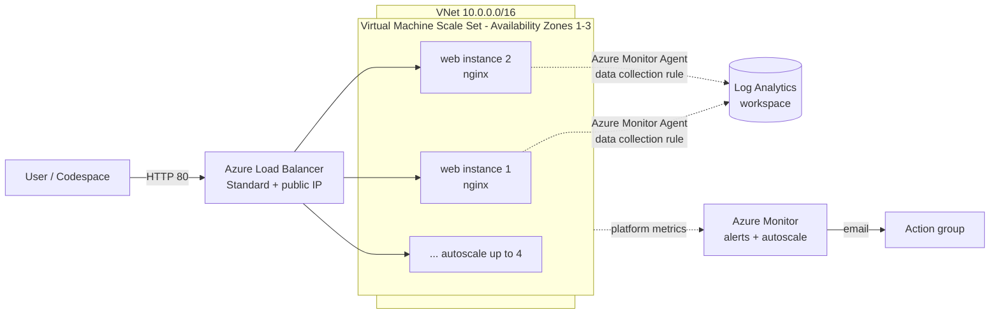

# Azure Observability and High Availability Hands-on Lab

**English** | [한국어](README.md)

[](https://codespaces.new/Taeyangmoon/azure-ha-ops-lab)
[](LICENSE)

> **Scenario**: When traffic spikes, the web service **scales out automatically** and the operator **gets an alert**.

In about 85 minutes, using only a few commands in a GitHub Codespaces terminal, you will experience Azure **high availability** (the service stays up when something fails) and **operational visibility** (you can see what is happening right now).

## Architecture



## Curriculum

| Module | Content | Time |
|---|---|---|
| [0. Prepare](docs/en/00-prepare.md) | Deploy VNet, Load Balancer, VM Scale Set (2 instances) and a Log Analytics workspace with one Bicep deployment | 10 min |
| [1. High availability](docs/en/01-high-availability.md) | Verify load balancing, stop one instance and confirm the service stays up | 15 min |
| [2. Monitoring](docs/en/02-monitoring.md) | Configure Azure Monitor Agent and a data collection rule, practice KQL | 25 min |
| [3. Alerts and autoscale](docs/en/03-alert-autoscale.md) | Create a CPU alert rule, an action group (email) and an autoscale rule, then generate load with stress and watch scale-out and the alert | 25 min |
| [4. Cost](docs/en/04-cost.md) | Budget and cost analysis by tag in Microsoft Cost Management | 5 min |
| [Cleanup](docs/en/05-cleanup.md) | `cleanup.sh` | 5 min |

## Getting started

1. Click **Open in GitHub Codespaces** above to create a Codespace. (Azure CLI and Bicep are preinstalled.)
2. Sign in to Azure in the terminal.
   ```bash
   az login --use-device-code
   ```
3. Follow the modules in order, starting with [Module 0](docs/en/00-prepare.md).

### Prerequisites

- An Azure subscription where you can create resources (**Contributor** or higher). Trial/free accounts work, but check your VM core quota (the default deployment uses up to 4 instances × 2 vCores).
- A GitHub account (for Codespaces)
- An email address to receive the alert

### Estimated cost

Roughly **under USD 1** for the whole lab (about 85 minutes); it varies by region and time. Always run [Cleanup](docs/en/05-cleanup.md) when you finish. Leftover resources keep billing.

## Repository layout

```text
.devcontainer/   Codespaces environment (Azure CLI + Bicep)
infra/           main.bicep (Module 0), module2-monitoring.bicep (Module 2), cloud-init.yaml
scripts/         deploy.sh, cleanup.sh, stress.sh, curl-loop.sh
queries/         lab-queries.kql (Module 2 KQL collection)
docs/ko, docs/en per-module lab guides
```

## Language

Script messages are Korean by default. Run `export LAB_LANG=en` first to get English messages.

## Script regression tests

Run `python3 -B -m unittest discover -s tests -v` to check error handling and cleanup target guards. The tests mock Azure CLI; they create no cloud resources and incur no Azure charges.

## License

[MIT](LICENSE)
