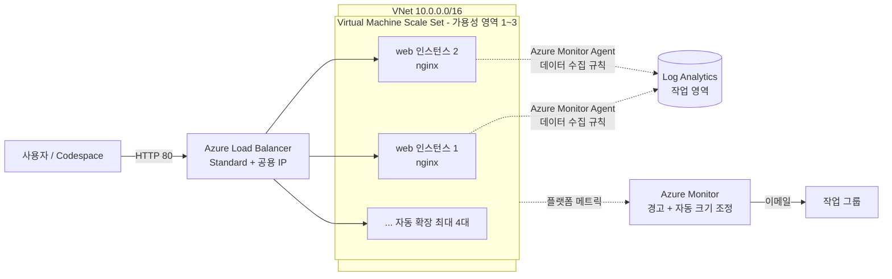

# Azure 운영 가시성과 고가용성 핸즈온 랩

[English](README.en.md) | **한국어**

[](https://codespaces.new/Taeyangmoon/azure-ha-ops-lab)
[](LICENSE)

> **시나리오**: 웹 서비스에 부하가 몰리면 **자동으로 확장**되고, 운영자는 **경고**를 받는다.

약 85분 동안 GitHub Codespaces 터미널에서 명령어 몇 줄만으로 Azure의 **고가용성**(장애가 나도 서비스가 유지됨)과 **운영 가시성**(지금 무슨 일이 일어나는지 볼 수 있음)을 직접 체험합니다.

## 아키텍처



## 커리큘럼

| 모듈 | 내용 | 시간 |
|---|---|---|
| [0. 준비](docs/ko/00-prepare.md) | Bicep으로 VNet, Load Balancer, VMSS(2대), Log Analytics 작업 영역을 한 번에 배포 | 10분 |
| [1. 고가용성](docs/ko/01-high-availability.md) | 부하 분산 동작 확인, 인스턴스 1대 중지 후 서비스 유지 확인 | 15분 |
| [2. 모니터링](docs/ko/02-monitoring.md) | Azure Monitor 에이전트와 데이터 수집 규칙 설정, KQL 쿼리 실습 | 25분 |
| [3. 경고와 자동 크기 조정](docs/ko/03-alert-autoscale.md) | CPU 경고 규칙, 작업 그룹(이메일), 자동 크기 조정 규칙 설정 후 stress로 부하를 걸어 확장과 경고 확인 | 25분 |
| [4. 비용](docs/ko/04-cost.md) | Cost Management에서 예산과 태그별 비용 분석 | 5분 |
| [정리](docs/ko/05-cleanup.md) | `cleanup.sh` | 5분 |

## 시작하기

1. 위의 **Open in GitHub Codespaces** 배지를 눌러 Codespace를 만듭니다. (Azure CLI, Bicep이 미리 설치되어 있습니다.)
2. 터미널에서 Azure에 로그인합니다.
   ```bash
   az login --use-device-code
   ```
3. [모듈 0](docs/ko/00-prepare.md)부터 순서대로 진행합니다.

### 준비물

- 리소스를 만들 수 있는 Azure 구독 (**Contributor** 이상 권한). 평가판/무료 계정도 가능하지만 VM 코어 할당량을 확인하세요(기본 배포는 최대 4대 × 2 vCore).
- GitHub 계정 (Codespaces 사용)
- 경고 메일을 받을 이메일 주소

### 예상 비용

랩 전체(약 85분)에서 **대략 1달러 미만**으로 예상되지만, 리전과 시점에 따라 다릅니다. 실습이 끝나면 반드시 [정리](docs/ko/05-cleanup.md)를 실행하세요. 리소스를 남겨 두면 계속 과금됩니다.

## 저장소 구성

```text
.devcontainer/   Codespaces 환경 (Azure CLI + Bicep)
infra/           main.bicep (모듈 0), module2-monitoring.bicep (모듈 2), cloud-init.yaml
scripts/         deploy.sh, cleanup.sh, stress.sh, curl-loop.sh
queries/         lab-queries.kql (모듈 2 KQL 모음)
docs/ko, docs/en 모듈별 실습 문서
```

## 영어 / English

모든 문서와 스크립트 메시지는 영어도 제공합니다. 스크립트 메시지를 영어로 보려면 `export LAB_LANG=en` 을 먼저 실행하세요. See [README.en.md](README.en.md).

## 라이선스

[MIT](LICENSE)
