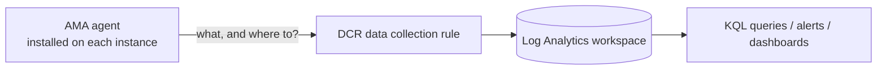

# Module 2. Monitoring (25 min)

[← Module 1](01-high-availability.md) | [Next: Module 3 →](03-alert-autoscale.md)

## Goals

- Understand how **Azure Monitor Agent (AMA)** and a **data collection rule (DCR)** work together.
- Send in-VM performance counters and system logs to Log Analytics.
- Query per-instance health with **KQL**.

## Key concepts

Azure provides **platform metrics** such as CPU automatically, but anything **inside** the VM (memory, disk, OS logs) needs an agent.



| Component | Role |
|---|---|
| AMA (Azure Monitor Agent) | Program inside the VM that collects and ships data (installed as a VMSS extension) |
| DCR (data collection rule) | Defines **what** to collect and **where** to send it |
| DCR association | Links the rule to resources. Associated with the VMSS, it **applies automatically to instances added later** |
| Log Analytics workspace | Where data lands (`Perf`, `Syslog`, `Heartbeat` tables) |

## Step 1. Install the agent (5 min)

> If you stopped an instance in Module 1, start everything first: `az vmss start -g $RG -n $VMSS`.

```bash
source .lab.env
az vmss extension set -g $RG --vmss-name $VMSS \
  -n AzureMonitorLinuxAgent --publisher Microsoft.Azure.Monitor \
  --enable-auto-upgrade true
```

Check that it reached the instances. (The upgrade policy is `Automatic`, so it rolls out by itself.)

```bash
az vmss extension list -g $RG --vmss-name $VMSS --query "[].{name:name, state:provisioningState}" -o table
az vmss list-instances -g $RG -n $VMSS --query "[].{id:instanceId, latestModel:latestModelApplied}" -o table
```

Wait 1-3 minutes until `latestModel` is `true` for all instances.

> The agent needs a **managed identity** to authenticate to Azure. The Module 0 Bicep already enabled it with `identity: SystemAssigned`.

## Step 2. Deploy the data collection rule (5 min)

```bash
az deployment group create -g $RG -n module2 \
  -f infra/module2-monitoring.bicep \
  -p vmssName=$VMSS workspaceName=$WORKSPACE -o none
```

Open [`infra/module2-monitoring.bicep`](../../infra/module2-monitoring.bicep) and read its structure.

- `dataSources.performanceCounters`: CPU, memory, disk and network every 30 s → `Perf` table
- `dataSources.syslog`: OS logs (auth, daemon, kern, ...) → `Syslog` table
- `destinations.logAnalytics`: the workspace to send to
- `dataCollectionRuleAssociations`: attaches this rule to the VMSS

**In the portal**: Monitor → Settings → **Data Collection Rules** → `dcr-halab-linux` → **Resources** tab shows the VMSS.

> To build one by hand: Monitor → Data Collection Rules → **Create**, and pick the same items (platform Linux, performance counters, Syslog, destination Log Analytics).

## Step 3. While data starts to flow (5-10 min)

The first data takes 5-10 minutes to appear. Send some traffic in the meantime.

```bash
scripts/curl-loop.sh 100
```

## Step 4. KQL practice (10 min)

In the portal open the Log Analytics workspace (`$WORKSPACE`) → **Logs**. (Close the initial query picker.) The queries below are also in [`queries/lab-queries.kql`](../../queries/lab-queries.kql). Run them **one at a time**.

### Q1. Is every instance reporting? (Heartbeat)

```kusto
Heartbeat
| where TimeGenerated > ago(15m)
| summarize LastHeartbeat = max(TimeGenerated), Beats = count() by Computer
| extend MinutesAgo = datetime_diff('minute', now(), LastHeartbeat)
```

Two instances with `MinutesAgo` of 0-1 is healthy. **An instance whose `MinutesAgo` keeps growing has stopped.**

### Q2. CPU per instance over time (Perf)

```kusto
Perf
| where TimeGenerated > ago(1h)
| where ObjectName == "Processor" and CounterName == "% Processor Time" and InstanceName == "_Total"
| summarize AvgCpu = avg(CounterValue) by bin(TimeGenerated, 1m), Computer
| render timechart
```

### Q3. Memory usage

```kusto
Perf
| where TimeGenerated > ago(1h)
| where ObjectName == "Memory" and CounterName == "% Used Memory"
| summarize AvgMem = avg(CounterValue) by bin(TimeGenerated, 1m), Computer
| render timechart
```

### Q4. OS logs (Syslog)

```kusto
Syslog
| where TimeGenerated > ago(1h)
| summarize Count = count() by Computer, Facility, SeverityLevel
| order by Count desc
```

### KQL at a glance

| Operator | Meaning |
|---|---|
| `where` | Filter by a condition |
| `summarize ... by` | Aggregate per group (like SQL GROUP BY) |
| `bin(TimeGenerated, 1m)` | Bucket time into 1-minute slices |
| `render timechart` | Show as a time-series chart |
| pipe character | Pass the previous result to the next operator |

### Query from the command line (optional)

```bash
az monitor log-analytics query -w $WORKSPACE_ID \
  --analytics-query "Heartbeat | summarize count() by Computer" -o table
```

### Challenges (optional)

1. Like in Module 1, stop an instance (`az vmss deallocate ... --instance-ids 0`) and watch `MinutesAgo` grow in Q1. Restore it with `az vmss start` afterward.
2. How would you change the query to show only the times CPU was above 70%? (Answer: query 5 in `queries/lab-queries.kql`)

## Troubleshooting

| Symptom | Fix |
|---|---|
| `Heartbeat` still empty after 10 minutes | Check the extension (`az vmss extension list`) and the DCR association (portal: DCR → Resources tab) |
| `latestModel` is `false` | `az vmss update-instances -g $RG -n $VMSS --instance-ids "*"` |
| Only `Perf` is empty | The 30 s sampling and ingestion delay can add a few minutes |

Next → [Module 3. Alerts and autoscale](03-alert-autoscale.md)
