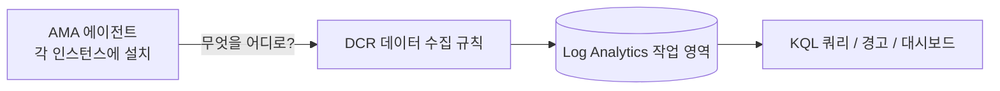

# 모듈 2. 모니터링 (25분)

[← 모듈 1](01-high-availability.md) | [다음: 모듈 3 →](03-alert-autoscale.md)

## 학습 목표

- **Azure Monitor 에이전트(AMA)** 와 **데이터 수집 규칙(DCR)** 의 관계를 이해한다.
- VM 내부의 성능 카운터와 시스템 로그를 Log Analytics로 보낸다.
- **KQL**로 인스턴스별 상태를 조회한다.

## 핵심 개념

Azure는 CPU 같은 **플랫폼 메트릭**을 자동으로 제공하지만, VM **내부**(메모리, 디스크, OS 로그)는 에이전트가 있어야 볼 수 있습니다.



| 구성 요소 | 역할 |
|---|---|
| AMA (Azure Monitor Agent) | VM 안에서 데이터를 수집해 전송하는 프로그램 (VMSS 확장으로 설치) |
| DCR (데이터 수집 규칙) | **무엇을** 수집하고 **어디로** 보낼지 정의 |
| DCR 연결 (association) | 어떤 리소스에 규칙을 적용할지 연결. VMSS에 연결하면 **새로 늘어나는 인스턴스에도 자동 적용** |
| Log Analytics 작업 영역 | 데이터가 저장되는 곳 (`Perf`, `Syslog`, `Heartbeat` 테이블) |

## 1단계. 에이전트 설치 (5분)

> 모듈 1에서 중지한 인스턴스가 있다면 먼저 `az vmss start -g $RG -n $VMSS` 로 모두 켜 두세요.

```bash
source .lab.env
az vmss extension set -g $RG --vmss-name $VMSS \
  -n AzureMonitorLinuxAgent --publisher Microsoft.Azure.Monitor \
  --enable-auto-upgrade true
```

인스턴스에 적용되었는지 확인합니다. (모델 업그레이드 정책이 `Automatic` 이라 자동으로 적용됩니다.)

```bash
az vmss extension list -g $RG --vmss-name $VMSS --query "[].{name:name, version:typeHandlerVersion}" -o table
az vmss list-instances -g $RG -n $VMSS --query "[].{instance:instanceId, latestModel:latestModelApplied}" -o table
```

`latestModel` 이 모두 `true` 가 될 때까지 1~3분 기다립니다.

> 에이전트가 Azure에 인증하려면 **관리 ID**가 필요합니다. 모듈 0의 Bicep에서 `identity: SystemAssigned` 로 이미 켜 두었습니다.

## 2단계. 데이터 수집 규칙 배포 (5분)

```bash
az deployment group create -g $RG -n module2 \
  -f infra/module2-monitoring.bicep \
  -p vmssName=$VMSS workspaceName=$WORKSPACE -o none
```

[`infra/module2-monitoring.bicep`](../../infra/module2-monitoring.bicep) 를 열어 구조를 읽어 보세요.

- `dataSources.performanceCounters`: CPU, 메모리, 디스크, 네트워크를 30초마다 수집 → `Perf` 테이블
- `dataSources.syslog`: auth, daemon, kern 등 OS 로그 → `Syslog` 테이블
- `destinations.logAnalytics`: 보낼 작업 영역
- `dataCollectionRuleAssociations`: 이 규칙을 VMSS에 연결

**포털에서 보기**: 모니터 → 설정 → **데이터 수집 규칙** → `dcr-halab-linux` → **리소스** 탭에 VMSS가 보입니다.

> 포털에서 직접 만들 때는 모니터 → 데이터 수집 규칙 → **만들기** 에서 같은 항목(플랫폼: Linux, 성능 카운터, Syslog, 대상: Log Analytics)을 선택합니다.

## 3단계. 데이터가 들어오기를 기다리며 (5~10분)

첫 데이터가 보이기까지 5~10분 걸립니다. 그동안 트래픽을 조금 보내 두세요.

```bash
scripts/curl-loop.sh 100
```

## 4단계. KQL 실습 (10분)

포털에서 Log Analytics 작업 영역(`$WORKSPACE`) → **로그** 를 엽니다. (처음 나오는 쿼리 선택 창은 닫으세요.) 아래 쿼리는 [`queries/lab-queries.kql`](../../queries/lab-queries.kql) 에도 있습니다. 한 번에 **하나씩** 실행하세요.

### Q1. 인스턴스가 모두 보고하고 있는가? (Heartbeat)

```kusto
Heartbeat
| where TimeGenerated > ago(15m)
| summarize LastHeartbeat = max(TimeGenerated), Beats = count() by Computer
| extend MinutesAgo = datetime_diff('minute', now(), LastHeartbeat)
```

인스턴스 2대가 나오고 `MinutesAgo` 가 0~1이면 정상입니다. **`MinutesAgo` 가 커지는 인스턴스가 있다면 멈춘 것입니다.**

### Q2. 인스턴스별 CPU 추이 (Perf)

```kusto
Perf
| where TimeGenerated > ago(1h)
| where ObjectName == "Processor" and CounterName == "% Processor Time" and InstanceName == "total"
| summarize AvgCpu = avg(CounterValue) by bin(TimeGenerated, 1m), Computer
| render timechart
```

### Q3. 메모리 사용률

```kusto
Perf
| where TimeGenerated > ago(1h)
| where ObjectName == "Memory" and CounterName == "% Used Memory"
| summarize AvgMem = avg(CounterValue) by bin(TimeGenerated, 1m), Computer
| render timechart
```

### Q4. OS 로그 (Syslog)

```kusto
Syslog
| where TimeGenerated > ago(1h)
| summarize Count = count() by Computer, Facility, SeverityLevel
| order by Count desc
```

### KQL 한눈에 보기

| 연산자 | 의미 |
|---|---|
| `where` | 조건으로 거르기 |
| `summarize ... by` | 그룹별 집계 (SQL의 GROUP BY) |
| `bin(TimeGenerated, 1m)` | 시간을 1분 단위로 묶기 |
| `render timechart` | 시계열 차트로 표시 |
| 파이프 문자 | 앞 결과를 다음 연산자로 전달 |

### 명령줄로 조회하기 (선택)

```bash
az monitor log-analytics query -w $WORKSPACE_ID \
  --analytics-query "Heartbeat | summarize count() by Computer" -o table
```

### 도전 과제 (선택)

1. 모듈 1처럼 인스턴스를 하나 중지(`az vmss deallocate ... --instance-ids 0`)하고, Q1에서 `MinutesAgo` 가 늘어나는 것을 확인해 보세요. 확인 후 `az vmss start` 로 되돌립니다.
2. CPU가 70%를 넘은 시점만 보려면 쿼리를 어떻게 바꿀까요? (정답은 `queries/lab-queries.kql` 의 5번)

## 문제 해결

| 증상 | 해결 |
|---|---|
| 10분이 지나도 `Heartbeat` 가 비어 있음 | 확장 상태(`az vmss extension list`)와 DCR 연결(포털의 DCR → 리소스 탭) 확인 |
| `latestModel` 이 `false` | `az vmss update-instances -g $RG -n $VMSS --instance-ids "*"` |
| `Perf` 만 비어 있음 | 수집 주기(30초)와 인입 지연 때문에 몇 분 더 걸릴 수 있음 |

다음 → [모듈 3. 경고와 자동 크기 조정](03-alert-autoscale.md)
